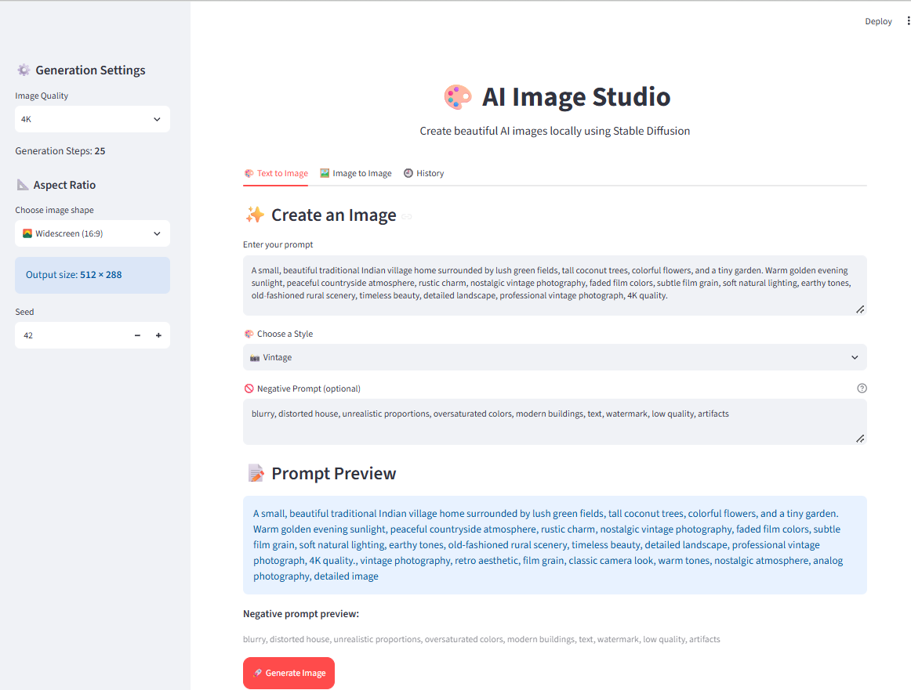
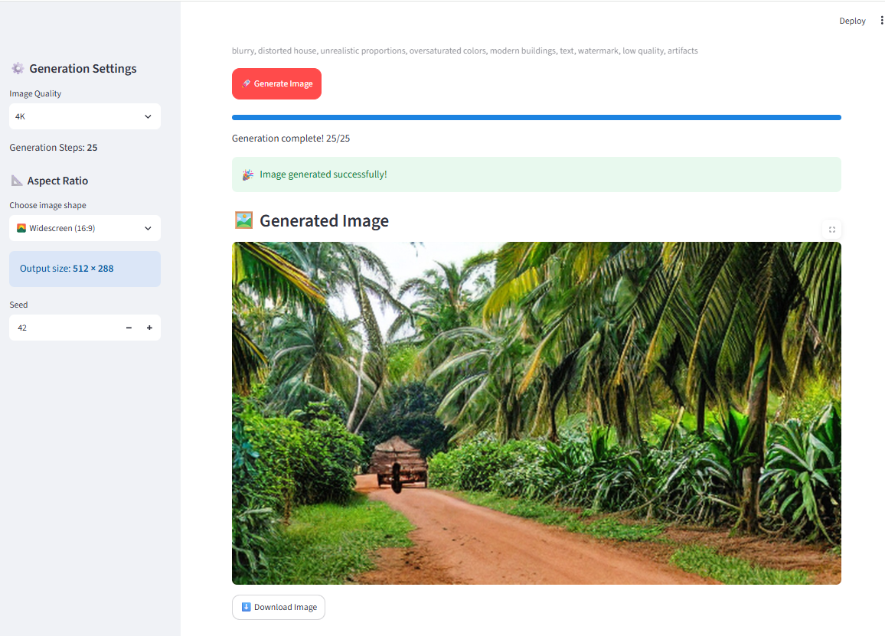

# 🎨 AI Image Generator

An AI-powered image generation application built with Python, Streamlit, and Stable Diffusion. Generate images from text prompts using a simple web interface.

## ✨ Features

- 📝 Generate images from text prompts.
- 🎨 Explore AI-generated artwork.
- ⚙️ Choose image-generation quality settings.
- 🖥️ Run Stable Diffusion locally using PyTorch.
- 📂 Save generated images to your computer.

## 🛠️ Technologies Used

- Python
- Streamlit
- PyTorch
- Hugging Face Diffusers
- Stable Diffusion
- Pillow

## 📁 Project Structure

```text
ai_img_gen/
├── app.py
├── config/
│   └── config.py
├── services/
│   └── image_generator.py
├── utils/
│   └── image_utils.py
├── requirements.txt
├── .gitignore
└── README.md
```

## 🚀 Getting Started

### 1. Clone the repository

```bash
git clone https://github.com/chethansree77/ai-image-generator.git
cd ai-image-generator
```

### 2. Create a virtual environment

```bash
python -m venv venv
```

Activate it on Windows PowerShell:

```powershell
.\venv\Scripts\Activate.ps1
```

### 3. Install dependencies

```bash
python -m pip install -r requirements.txt
```

**Note:** If your application imports PyTorch or Diffusers, ensure those packages are installed as required by your local setup. The exact installation may depend on your hardware and Python version.

### 4. Run the application

```bash
python -m streamlit run app.py
```

Open the local URL displayed in your terminal.

## 🔒 Security

- Keep API keys and secrets in a local `.env` file.
- Never upload `.env`, passwords, or access tokens to GitHub.
- Generated images and virtual environments are excluded through `.gitignore`.

## 👩‍💻 Author

**Chethana Sai Sree**

- GitHub: [@chethansree77](https://github.com/chethansree77)

---

⭐ If you find this project interesting, feel free to explore the repository!


## 📸 Screenshots

### Screenshot 1 — AI Image Generator


### Screenshot 2 — Generated Image

